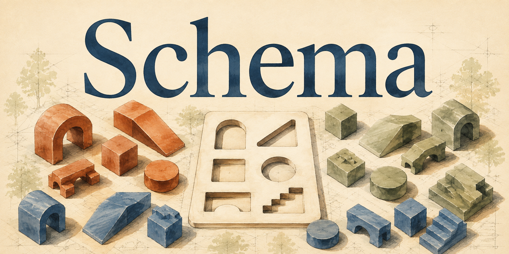

# schema

[](https://github.com/mas-bandwidth/schema/actions/workflows/ci-fast.yml)
[](LICENSE)

**Schema. The data language for games.**



Schema is a data language where you define your constants, enums, flags, types and tables for your game, then from this one definition, it generates code in C, C++, C# (modern), C# (unity), Dart, Elixir, Go, Goose, Java, JavaScript, Lobster, Lua, Luau, Moo, Python, Ruby, Rust and Squirrel.

Schema is currently under active development. See **[ROADMAP.md](ROADMAP.md)** for details.

If this work helps you, **[please support it.](https://www.patreon.com/MasBandwidth/membership)**

## Design

Schema is designed to support the following use-cases in game development:

* Packets sent between a client and server.
* Messages sent between your server and backend.
* Asset file formats and recursive data structures.
* Save game files that must load in a future game build.
* Game assets cooked to an efficient runtime binary format.
* Render data written in one language and read in another - sixty times per-second.

## Example

```
package example

const MaxHealth = 1000

enum ShipType { Fighter, Corvette, Bomber }

flags ShipFlags { Firing, Thrusting, Disabled }

type Vec3
{
    x float64
    y float64
    z float64
}

type Quaternion
{
    x float64
    y float64
    z float64
    w float64 = 1.0
}

type ShipState
{
    ship_type  ShipType
    ship_flags ShipFlags
    position   Vec3
    rotation   Quaternion
    health     int32      | min = 0, max = MaxHealth
    at_rest    bool
    if !at_rest
    {
        linear_velocity  Vec3
        angular_velocity Vec3
    }
}
```

## Performance

Cost to serialize a representative game packet, relative to generated C++ at 100%. Lower is faster.

| Language | % |
|---|---:|
| C | 100% |
| C++ | 100% |
| Rust | 166% |
| Java | 170% |
| Go | 228% |
| C# | 238% |
| Dart | 266% |
| JavaScript | 288% |
| Elixir | 1479% |

## Install and build

With a Go toolchain (1.26 or later), one command installs the compiler as
`schema` in `$(go env GOPATH)/bin`:

```
go install github.com/mas-bandwidth/schema/v2/cmd/schema@main
schema version
```

This builds the head of `main`, where every release is tagged. Nothing else is
needed: no `make`, no generated files, no other toolchain. `schema version`
prints the Go module version, which ends in the commit it was built from. Do
not use `@latest`: the module path still ends in `/v2`, so Go resolves it to
v2.5.0 rather than the newest release.

**Prebuilt binaries.** From the first release after v3.0.1, every
[release](https://github.com/mas-bandwidth/schema/releases) carries
`schema_<version>_<os>_<arch>.tar.gz` (`.zip` for Windows) for linux, darwin
and windows on amd64 and arm64, and a `SHA256SUMS` file. Unpack one and put
`schema` on your path; it needs nothing else.

**From source**, for a binary stamped with `git describe`:

```
git clone https://github.com/mas-bandwidth/schema.git
cd schema
make                # builds the compiler at bin/schema
```

The commands:

```
schema check    <dir of .schema files>
schema generate --lang c|cpp|cs|dart|elixir|go|goose|java|js|lobster|lua|luau|python|ruby|rust|squirrel|unity --out <outdir> <dir>
schema fmt      <dir of .schema files>
```

`--lang unity` is C# (unity) and `--lang cs` is C# (modern). The default build
refuses `--lang moo`; Moo needs a compiler built with `-tags schema_leg_moo`.

`fmt` is the only command that writes a `.schema` file. Every other command
reads your schema files and leaves them alone, so a read-only checkout, a
sandboxed build and an editor integration all work.

## Documentation

| Document | What's in it |
|---|---|
| **[ROADMAP.md](ROADMAP.md)** | Where schema stands, feature by feature and language by language, what we are building next, and how to support the work. |
| **[TUTORIAL.md](docs/TUTORIAL.md)** | Fourteen parts, from an empty directory to a program that uses every feature. Start here. |
| **[USAGE.md](docs/USAGE.md)** | Every language feature, with the code it generates. |
| **[SPEC.md](docs/SPEC.md)** | The normative reference for the type wire: grammar, wire law, every edge case. |
| **[SPEC-TABLES.md](docs/SPEC-TABLES.md)** | The normative reference for tables: the wire, the cook, the block form, reflection, the build version. |
| **[AI.md](docs/AI.md)** | For AI assistants: the whole language on one page, the commands, calling the generated code, and the mistakes to avoid. `schema help ai` prints a block to paste into your project's AGENTS.md. |

Beside them: [PORTING.md](docs/PORTING.md) (the techniques register: every
method and instrument a table backend carries, with a cell per language and a
gate), [PERFORMANCE.md](docs/PERFORMANCE.md),
[COMPARISON-TABLES.md](docs/COMPARISON-TABLES.md) (tables against FlatBuffers and
Protobuf, feature by feature, with the verdict on every gap),
[COMPARISON.md](docs/COMPARISON.md) (the same packet against Cap'n Proto, Protobuf
and FlatBuffers), [COMPETITION.md](docs/COMPETITION.md) (the standing comparison
against Protocol Buffers, FlatBuffers, Cap'n Proto and Avro),
[FAQ.md](docs/FAQ.md), [VERSIONING.md](docs/VERSIONING.md),
[CONTRIBUTING.md](docs/CONTRIBUTING.md) and [SECURITY.md](docs/SECURITY.md).

## License

**The compiler is AGPL-3.0. The code it generates is yours.**

The compiler is licensed under the GNU Affero General Public License v3.0,
with an explicit additional permission for generated output written into
[LICENSE](LICENSE) itself and carried in every generated file's own header.
The output the compiler produces from your schema files belongs to you, under
whatever terms you choose, including in closed-source projects. That grant is
intentional and permanent. If you modify the compiler and run it as a service
or distribute it, the AGPL's terms apply to those modifications.

Contributing is a separate matter. Contributions are made under a Contributor
Assignment Agreement, described in
[CONTRIBUTING.md](docs/CONTRIBUTING.md#the-contributor-assignment-agreement).

## Author

Glenn Fiedler and Rowan Claude, Más Bandwidth LLC.
